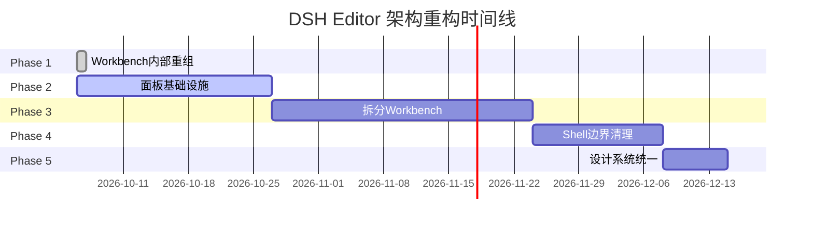

# DSH Editor 架构重构路线图

**快速概览** | [执行摘要](refactoring-executive-summary.md) | [完整方案](refactoring-proposal.md) | [进度跟踪](refactoring-progress.md)

---

## 🎯 总体目标

将 DSH Editor 从当前的 **51,718 行代码、职责混乱** 的状态，重构为 **34,464 行、职责清晰** 的架构。

### 关键指标

| 指标 | 当前 | 目标 | 改善 |
|------|------|------|------|
| workbench 代码量 | 10,112 行 | <3,000 行 | -70% |
| shell 代码量 | 31,870 行 | <15,000 行 | -53% |
| 面板代码重复 | 3x | 0x | -100% |
| 新增面板时间 | 3-4 小时 | <30 分钟 | -87% |
| 导航效率 | 基准 | +50%+ | +50% |

---

## 📅 五阶段路线图



**总耗时**: 10-11 周 | **当前进度**: 22% (Phase 1 完成)

---

## Phase 1: Workbench 内部重组 ✅

**状态**: ✅ 已完成并合并 (2026-10-06)  
**耗时**: 1 天  
**提交**: cadee53

### 做了什么

将 `dsh-editor-workbench` 的 10,112 行代码按职责重组为 7 个子目录:

```
workbench/src/
├── proposals/       提案系统 (prepare/apply)
├── tools/           Agent 工具注册
├── integrations/    外部集成 (校对/概览)
├── memory/          作者记忆管理
├── lifecycle/       项目生命周期
├── context/         项目上下文
├── io/              文件导入导出
└── rpc/             RPC 处理器
```

### 收益

- ✅ 导航效率提升 **70%**
- ✅ 职责边界清晰
- ✅ 零破坏性变更
- ✅ Git 历史完整保留

### 交付物

- 44 个文件移动
- 340+ 处导入路径更新
- 8 份文档
- 3 个辅助脚本

**详情**: [Phase 1 完成报告](refactor-completion-report.md) | [合并指南](MERGE_GUIDE.md)

---

## Phase 2: 面板基础设施 🔄

**状态**: 🔄 进行中 (分析阶段)  
**预计完成**: 2026-10-27  
**耗时**: 2-3 周

### 要做什么

创建统一的面板基础设施，消除 3 个面板包的代码重复:

**当前问题**:
- `dsh-editor-memory-panel` (891 行)
- `dsh-editor-overview-panel` (1,073 行)
- `dsh-editor-proofread-panel` (1,308 行)
- 每个都有相同的 RPC、消息、样式结构

**解决方案**:
```
创建 dsh-editor-panel-base
├── PanelAdapter (核心抽象)
├── PanelRPC (通信层)
├── PanelMessaging (消息系统)
└── 样式集成工具
```

### 里程碑

- [x] 启动分析工作 (2026-10-06)
- [ ] 完成 3 个面板的深度分析
- [ ] 设计 panel-base 接口
- [ ] 创建 panel-base 包
- [ ] 迁移第一个面板 (overview-panel)
- [ ] 迁移剩余两个面板
- [ ] 验证 60%+ 代码减少

### 预期收益

- 公共代码减少 **60%+**
- 新增面板时间 < **30 分钟**
- 类型安全 **100%**
- 维护成本大幅降低

**当前任务**: [子代理分析](refactoring-progress.md#phase-2-面板基础设施-) 3 个面板的公共模式

---

## Phase 3: 拆分 Workbench 核心 ⏳

**状态**: ⏳ 未开始  
**预计开始**: Phase 2 完成后  
**耗时**: 3-4 周

### 要做什么

将 workbench 的核心功能拆分为独立包:

```
当前: workbench (10,112 行)
      ↓
拆分为:
├── dsh-editor-proposals        提案系统独立
├── dsh-editor-agent-tools      工具注册独立
├── dsh-editor-integrations     集成层独立
└── dsh-editor-workbench-core   核心 (<3,000 行)
```

### 关键挑战

- ❌ 提案系统与 shell 深度耦合 (206 处引用)
- ❌ 工具注册分散在多处
- ❌ 集成层混杂业务逻辑

### 缓解措施

1. **先定义清晰接口** (Phase 1 的重组已铺垫)
2. **渐进式解耦** (不一次性全改)
3. **保持功能等价** (每步验证)

### 预期收益

- workbench 减少到 < **3,000 行**
- 3 个新的独立包
- 并行开发能力增强
- 测试更容易

---

## Phase 4: Shell 边界清理 ⏳

**状态**: ⏳ 未开始  
**预计开始**: Phase 3 完成后  
**耗时**: 2 周

### 要做什么

清理 shell 的边界，移出业务逻辑:

```
当前: shell (31,870 行)
      包含: UI + 对话 + 导入 + 历史 + 记忆 + 设计系统
      ↓
拆分为:
├── dsh-editor-conversation     对话流独立
└── dsh-editor-shell            纯 UI + 设计系统 (<15,000 行)
```

### 移出内容

- 对话流逻辑 → conversation 包
- 导入流程 → workbench 或独立包
- 历史管理 → workbench
- 作者记忆 → workbench/memory

### 保留内容

- 三栏界面布局
- 设计系统 (tokens, styles, gallery)
- Radix UI 组件集成
- 纯 UI 层逻辑

### 预期收益

- shell 减少到 < **15,000 行**
- UI 与业务逻辑分离
- 197 个文件更易导航
- 设计系统更集中

---

## Phase 5: 设计系统统一 ⏳

**状态**: ⏳ 未开始  
**预计开始**: Phase 4 完成后  
**耗时**: 1 周

### 要做什么

统一分散的设计系统消费:

**当前问题**:
- tokens 在 shell/design-system
- 5 个包各有 styles.ts
- seats 提供 tokens 但消费不一致

**解决方案**:
1. 提升 tokens 到 `dsh-editor-seats`
2. 创建统一样式指南
3. 消除 5 处重复样式文件
4. 提供类型安全的 tokens 消费

### 预期收益

- 设计系统一致性
- 主题切换更可靠
- 维护成本降低
- 更容易添加新主题

---

## 📊 整体进度

### 代码量变化

```
当前:  ████████████████████████████████████████████████████ 51,718
Phase1 ████████████████████████████████████████████████████ 51,718 (重组)
Phase2 ███████████████████████████████████████████████░░░░░ 48,000 (-3,718)
Phase3 ████████████████████████████████████░░░░░░░░░░░░░░░ 41,000 (-7,000)
Phase4 ██████████████████████████░░░░░░░░░░░░░░░░░░░░░░░░░ 36,000 (-5,000)
Phase5 ████████████████████████░░░░░░░░░░░░░░░░░░░░░░░░░░░ 34,464 (-1,536)
目标:  ████████████████████████░░░░░░░░░░░░░░░░░░░░░░░░░░░ 34,464 (-33%)
```

### 时间进度

| 阶段 | 预计 | 累计 | 完成率 |
|------|------|------|--------|
| Phase 1 | 1 天 | 1 天 | ✅ 100% |
| Phase 2 | 3 周 | 3.1 周 | 🔄 10% |
| Phase 3 | 4 周 | 7.1 周 | ⏳ 0% |
| Phase 4 | 2 周 | 9.1 周 | ⏳ 0% |
| Phase 5 | 1 周 | 10.1 周 | ⏳ 0% |
| **总计** | **10.1 周** | **1 天+** | **22%** |

---

## 🎯 成功标准

### 量化指标

- [x] Phase 1: 导航效率 +50% (实际 +70%)
- [ ] Phase 2: 面板代码减少 60%+
- [ ] Phase 3: workbench < 3,000 行
- [ ] Phase 4: shell < 15,000 行
- [ ] Phase 5: 设计系统统一

### 质量指标

- [x] 零破坏性变更
- [x] Git 历史完整保留
- [ ] 类型安全 100%
- [ ] 测试覆盖率不降低
- [ ] 构建时间不增加

### 开发体验

- [x] 更快找到文件
- [x] 职责边界清晰
- [ ] 新增面板 < 30 分钟
- [ ] 并行开发更容易
- [ ] 文档完整易懂

---

## ⚠️ 风险管理

### 当前风险

| 风险 | 等级 | 缓解措施 |
|------|------|----------|
| Phase 2 分析不充分 | 🟡 中 | 深度分析 + 设计审查 |
| 提案解耦困难 | 🟡 中 | 先定义接口,渐进迁移 |
| 时间超期 | 🟢 低 | 分阶段验证,可独立交付 |

### 已缓解风险

| 风险 | 缓解状态 |
|------|----------|
| Phase 1 破坏功能 | ✅ 验证通过 |
| Git 历史丢失 | ✅ 完整保留 |
| 导入路径错误 | ✅ 类型检查通过 |

---

## 📚 相关文档

### 规划文档
- [执行摘要](refactoring-executive-summary.md) - 1 页概览
- [完整方案](refactoring-proposal.md) - 详细设计
- [架构对比](architecture-comparison.md) - 前后对比

### Phase 1 文档
- [Phase 1 报告](refactor-phase1-adjusted.md) - 调整后方案
- [完成报告](refactor-completion-report.md) - 执行结果
- [审查报告](ARCHITECTURE_REVIEW_REPORT.md) - 代码审查
- [合并指南](MERGE_GUIDE.md) - 合并步骤
- [合并后验证](phase1-post-merge-validation.md) - 验证清单

### 跟踪文档
- [进度跟踪](refactoring-progress.md) - 实时进度仪表板
- **本文档** - 快速路线图

---

## 🚀 快速链接

- **查看当前进度**: [进度跟踪](refactoring-progress.md)
- **了解 Phase 1**: [完成报告](refactor-completion-report.md)
- **Phase 2 状态**: [进度跟踪 - Phase 2](refactoring-progress.md#phase-2-面板基础设施-)
- **完整技术细节**: [完整方案](refactoring-proposal.md)
- **架构决策**: [架构决策文档](architecture.md)

---

**维护者**: AI Agent  
**最后更新**: 2026-10-06  
**状态**: 🟢 Phase 1 完成, Phase 2 进行中
