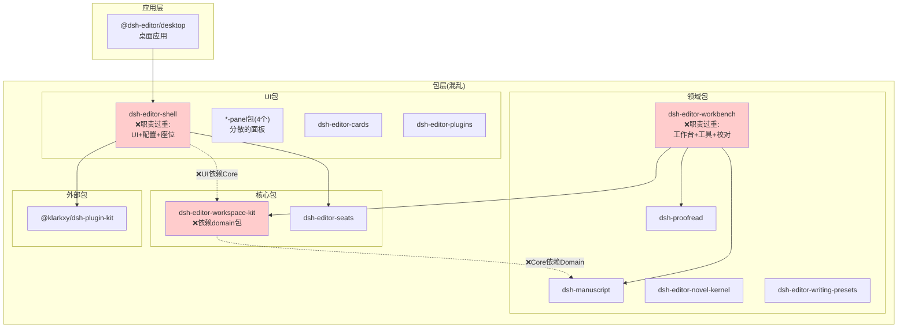
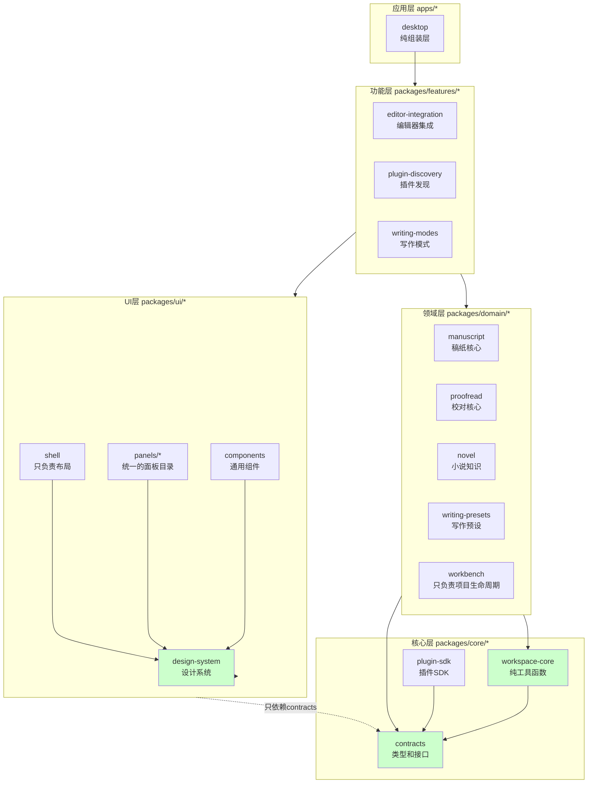

# DSH Editor 架构对比

## 当前架构(存在问题)



**关键问题:**
- ❌ **依赖方向混乱**: UI层(shell) → Core层(workspace-kit) → Domain层(manuscript)
- ❌ **职责不清**: shell和workbench包含多个不相关的功能
- ❌ **工具库位置错误**: workspace-kit应该是纯工具,却依赖具体领域包
- ❌ **面板包分散**: 4个*-panel包各自独立,缺少统一组织

---

## 目标架构(清晰分层)



**改进点:**
- ✅ **清晰的依赖方向**: App → Features → UI/Domain → Core
- ✅ **单一职责**: 每个包职责明确,易于理解和维护
- ✅ **正确的分层**: UI不依赖Domain实现,Core不依赖Domain
- ✅ **统一组织**: 同类包放在一起(ui/panels/*)

---

## 依赖方向对比

### 当前(错误)
```
desktop → shell → workspace-kit → manuscript
  (app)    (ui)      (core)        (domain)
  
❌ 依赖方向: App → UI → Core → Domain (违反分层原则)
```

### 目标(正确)
```
desktop → features → ui ──────→ core
  (app)    (feature)  (ui)         ↓
                        ↓           contracts
                      domain ──→ (types)
                    (business)
                    
✅ 依赖方向: App → Features → (UI + Domain) → Core
✅ UI和Domain处于同一层,都依赖Core,但互不依赖
```

---

## 包重组映射表

| 当前位置 | 目标位置 | 变化说明 |
|---------|---------|----------|
| `packages/dsh-editor-shell` | `packages/ui/shell` | 拆分:配置移到features,只保留布局 |
| `packages/dsh-editor-workbench` | `packages/domain/workbench` | 拆分:工具RPC移到features |
| `packages/dsh-editor-workspace-kit` | `packages/core/workspace-core` | 重构:移除对manuscript的依赖 |
| `packages/dsh-editor-seats` | `packages/core/plugin-sdk` | 合并到统一的插件SDK |
| `packages/dsh-manuscript` | `packages/domain/manuscript` | 简单移动,职责不变 |
| `packages/dsh-proofread` | `packages/domain/proofread` | 简单移动,职责不变 |
| `packages/dsh-editor-novel-kernel` | `packages/domain/novel` | 简单移动,职责不变 |
| `packages/dsh-editor-writing-presets` | `packages/domain/writing-presets` | 简单移动,职责不变 |
| `packages/dsh-editor-*-panel` (4个) | `packages/ui/panels/*` | 统一组织到panels目录 |
| `packages/dsh-editor-plugins` | `packages/features/plugin-discovery` | 移动到功能层 |
| 新增 | `packages/core/contracts` | 提取所有共享类型 |
| 新增 | `packages/ui/design-system` | 从shell提取设计系统 |
| 新增 | `packages/features/editor-integration` | 新的集成层 |
| 新增 | `packages/features/writing-modes` | 从shell提取写作模式配置 |

---

## 关键改进

### 1. 消除循环依赖和反向依赖
**问题**: UI层(shell)依赖Core层(workspace-kit),Core层又依赖Domain层(manuscript)

**解决**: 
- workspace-kit重构为纯工具库,不依赖任何domain包
- shell不直接依赖workspace-kit,通过contracts接口交互
- 建立单向依赖: App → Features → (UI + Domain) → Core

### 2. 明确职责边界
**问题**: shell和workbench职责过多

**解决**:
- shell拆分: UI布局保留 + 配置UI移到features/writing-modes
- workbench拆分: 项目生命周期保留 + 工具RPC移到features/editor-tools
- 每个包只做一件事

### 3. 统一同类包组织
**问题**: 4个panel包分散在packages根目录

**解决**:
- 创建 `packages/ui/panels/*` 统一目录
- 共享面板基础组件和座位使用方式
- 便于批量管理和维护

### 4. 建立清晰的抽象层
**问题**: 缺少共享的类型定义和接口契约

**解决**:
- 创建 `packages/core/contracts` 作为类型层
- 所有包通过contracts定义依赖关系
- 降低耦合,提高可测试性

---

## 迁移优先级

### P0 - 必须完成(阻塞性问题)
1. 消除 `workspace-kit → manuscript` 的反向依赖
2. 拆分 `shell` 的配置管理职责
3. 建立 `core/contracts` 类型层

### P1 - 高优先级(架构清晰性)
4. 重组所有 `*-panel` 包到统一目录
5. 拆分 `workbench` 的工具RPC职责
6. 提取设计系统为独立包

### P2 - 中优先级(组织优化)
7. 移动domain包到新目录结构
8. 创建features层
9. 更新所有文档和导入路径

---

## 下一步行动

1. **评审会议**: 与团队讨论本方案,收集反馈
2. **细化设计**: 确定第一阶段的具体API边界
3. **准备工具**: 开发自动化迁移脚本
4. **创建分支**: 建立 `refactor/architecture-v2` 分支
5. **开始P0迁移**: 先解决最严重的反向依赖问题
