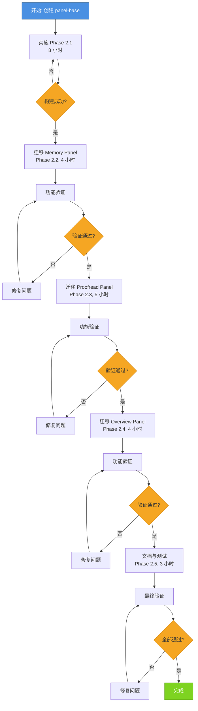
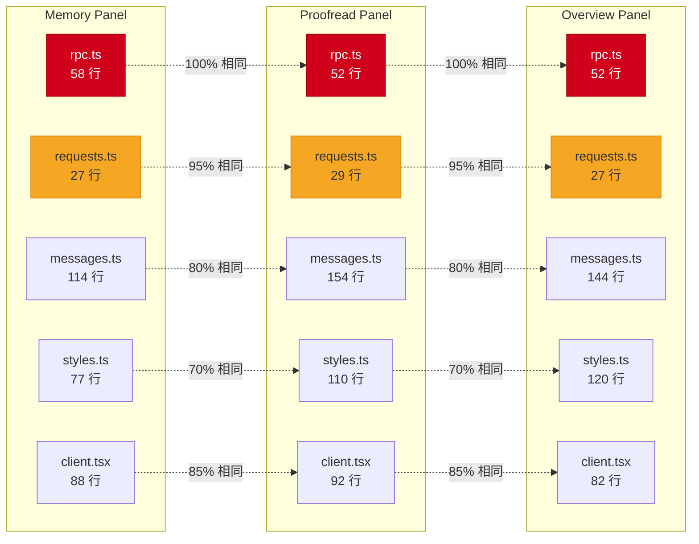
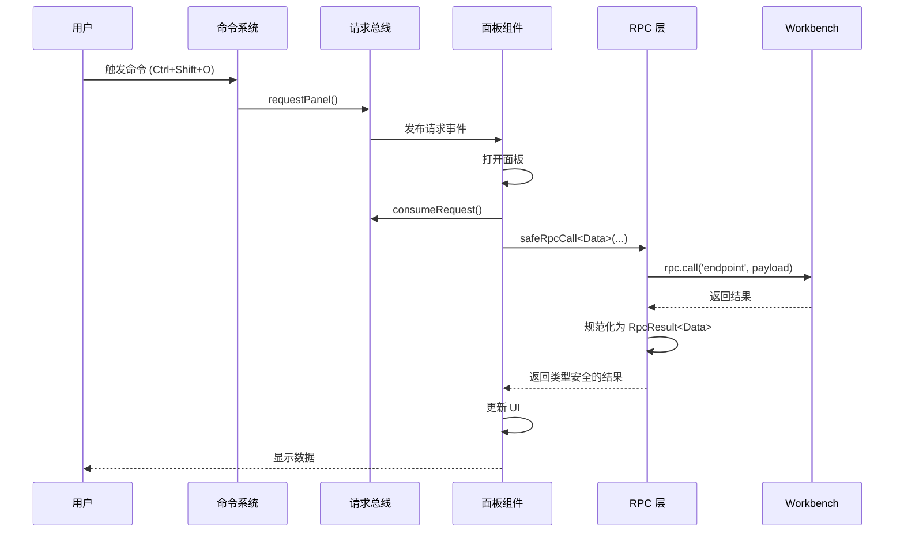
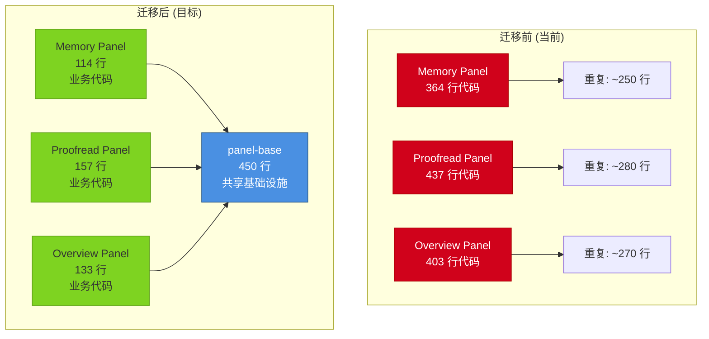
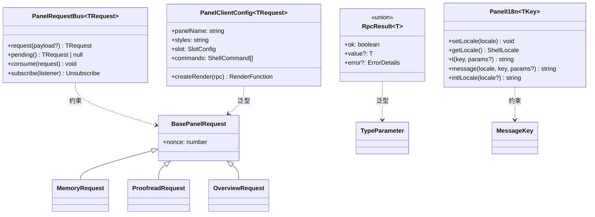
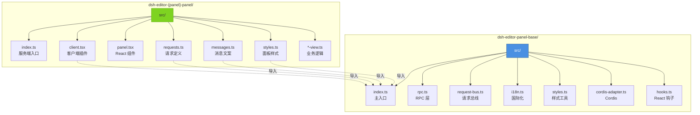
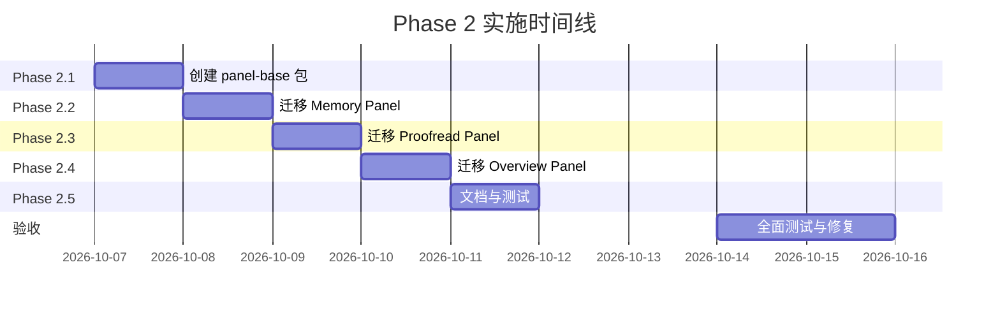
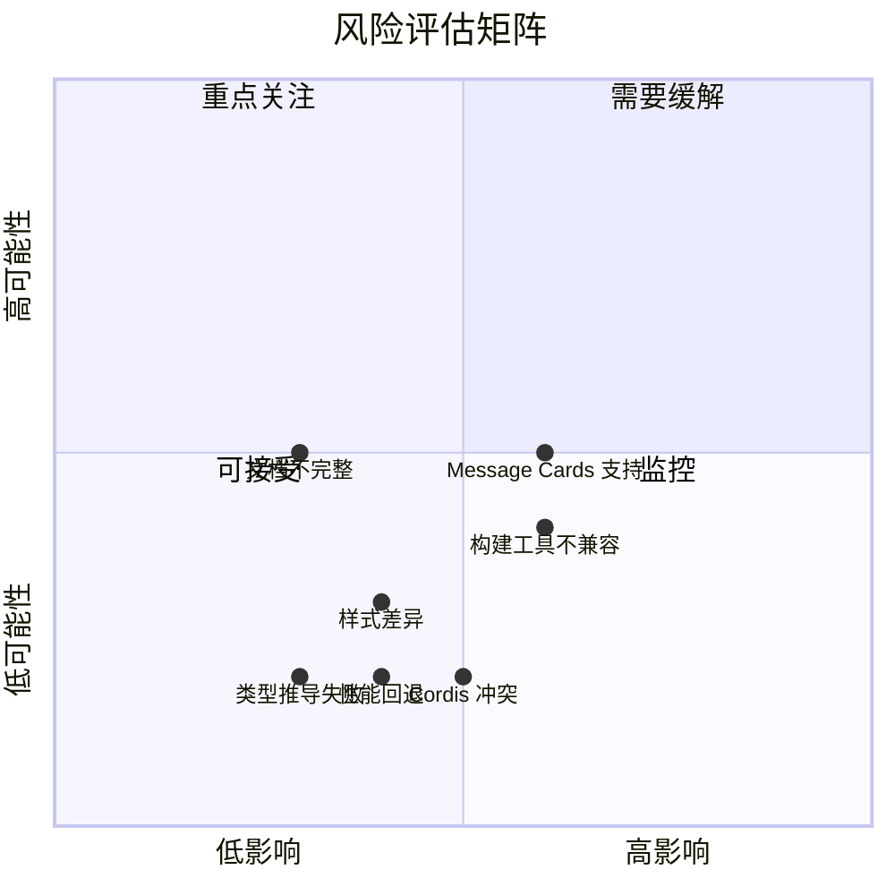

# Phase 2: 架构可视化

> **历史留档**: 本文档为 Phase 1 可视化材料，已被 [架构重构权威计划](refactoring/refactoring-plan.md) 整合。保留历史正文供参考。

本文档包含 Phase 2 面板基础设施的所有架构图。

---

## 1. 系统分层架构

```mermaid
graph TB
    subgraph "面板层 (Panel Layer)"
        MP[Memory Panel<br/>记忆维护]
        PP[Proofread Panel<br/>文稿校对]
        OP[Overview Panel<br/>文档概览]
        NP[New Panel<br/>未来面板]
    end
    
    subgraph "基础设施层 (Infrastructure Layer)"
        PB[dsh-editor-panel-base<br/>面板基础设施]
        
        subgraph "核心模块"
            RPC[RPC Client<br/>safeRpcCall, LatestRequestGate]
            REQ[Request Bus<br/>createPanelRequestBus]
            I18N[I18n Factory<br/>createPanelI18n]
            STY[Style Utils<br/>panelContainerStyles]
            CORD[Cordis Adapter<br/>createPanelClient]
            HOOKS[React Hooks<br/>usePanelRequest, usePanelRpc]
        end
    end
    
    subgraph "平台层 (Platform Layer)"
        SEATS[dsh-editor-seats<br/>Shell 契约]
        WB[dsh-editor-workbench<br/>RPC 端点]
        CORDIS[@deepseek-ai/cordis<br/>插件系统]
        REACT[React<br/>UI 框架]
    end
    
    MP --> PB
    PP --> PB
    OP --> PB
    NP --> PB
    
    PB --> RPC
    PB --> REQ
    PB --> I18N
    PB --> STY
    PB --> CORD
    PB --> HOOKS
    
    CORD --> CORDIS
    HOOKS --> REACT
    PB --> SEATS
    
    MP --> WB
    PP --> WB
    OP --> WB
    NP --> WB
    
    style PB fill:#4A90E2,stroke:#2E5C8A,stroke-width:3px,color:#fff
    style MP fill:#7ED321,stroke:#5FA019
    style PP fill:#7ED321,stroke:#5FA019
    style OP fill:#7ED321,stroke:#5FA019
    style NP fill:#F8E71C,stroke:#D4C01A
```

---

## 2. 依赖关系图

```mermaid
graph LR
    subgraph "新增包"
        PB[dsh-editor-panel-base]
    end
    
    subgraph "现有平台包"
        SEATS[dsh-editor-seats]
        WB[dsh-editor-workbench]
    end
    
    subgraph "面板包"
        MP[memory-panel]
        PP[proofread-panel]
        OP[overview-panel]
    end
    
    subgraph "外部依赖"
        CORDIS[@deepseek-ai/cordis]
        REACT[react]
    end
    
    PB --> SEATS
    PB --> CORDIS
    PB --> REACT
    
    MP --> PB
    PP --> PB
    OP --> PB
    
    MP --> WB
    PP --> WB
    OP --> WB
    
    MP -.不直接依赖.-> SEATS
    PP -.不直接依赖.-> SEATS
    OP -.不直接依赖.-> SEATS
    
    style PB fill:#4A90E2,stroke:#2E5C8A,stroke-width:3px,color:#fff
    style SEATS fill:#E8E8E8,stroke:#999
    style WB fill:#E8E8E8,stroke:#999
```

**关键约束**:
- ✅ `panel-base` 不依赖 `workbench`（避免循环）
- ✅ 面板包通过 `panel-base` 间接使用 `seats`
- ✅ RPC 调用由面板直接发起到 `workbench`

---

## 3. 迁移流程图



---

## 4. 代码重复热力图



**颜色说明**:
- 🔴 红色: 100% 重复（必须提取）
- 🟠 橙色: 80%+ 重复（应该提取）
- 🟡 黄色: 60%+ 重复（可以提取）

---

## 5. 数据流图



---

## 6. 迁移前后对比



**统计**:
- 迁移前: 1204 行（含重复）
- 迁移后: 854 行（共享基础 + 业务代码）
- **减少**: 350 行（29%）
- **重复消除**: 800 行重复代码 → 450 行共享代码

---

## 7. 类型系统设计



---

## 8. 文件组织结构



---

## 9. 时间线甘特图



---

## 10. 风险矩阵



---

## 使用说明

1. 复制对应的 Mermaid 代码到支持 Mermaid 的编辑器（如 Typora、VS Code + 插件）
2. 或访问 [Mermaid Live Editor](https://mermaid.live/) 在线预览
3. 导出为 PNG/SVG 用于演示文档

---

**文档版本**: v1.0  
**最后更新**: 2026-10-06
