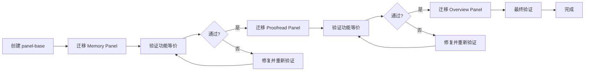

# Phase 2: 面板迁移计划

> **历史留档**: 本文档为 Phase 1 迁移分析材料，已被 [架构重构权威计划](refactoring/refactoring-plan.md) 整合。保留历史正文供参考。

**日期**: 2026-10-06  
**状态**: 迁移路线图  
**依赖**: [分析报告](./phase2-panel-analysis.md), [设计文档](./phase2-panel-design.md)

---

## 目录

1. [迁移概览](#1-迁移概览)
2. [迁移顺序](#2-迁移顺序)
3. [分步骤迁移](#3-分步骤迁移)
4. [风险评估](#4-风险评估)
5. [验证清单](#5-验证清单)
6. [回滚策略](#6-回滚策略)

---

## 1. 迁移概览

### 1.1 迁移策略

**增量迁移 + 功能等价验证**



### 1.2 时间估算

| 阶段 | 任务 | 预计时间 | 累计时间 |
|------|------|----------|----------|
| Phase 2.1 | 创建 `dsh-editor-panel-base` | 8 小时 | 8h |
| Phase 2.2 | 迁移 Memory Panel | 4 小时 | 12h |
| Phase 2.3 | 迁移 Proofread Panel | 5 小时 | 17h |
| Phase 2.4 | 迁移 Overview Panel | 4 小时 | 21h |
| Phase 2.5 | 文档与测试 | 3 小时 | 24h |
| **总计** | | **24 小时 (3 工作日)** | |

### 1.3 成功标准

- ✅ 所有现有功能正常工作（点击、快捷键、RPC 调用）
- ✅ UI 视觉无变化（样式、动画、布局）
- ✅ 类型检查通过（无 TypeScript 错误）
- ✅ 构建成功（`pnpm build` 无错误）
- ✅ 代码量减少 60%+（公共代码集中在 base）
- ✅ 新增面板时间 < 30 分钟（验证工具链）

---

## 2. 迁移顺序

### 2.1 为什么先迁移 Memory Panel?

**选择理由**:

1. **代码最简单**: 461 行，无复杂的业务逻辑分离文件
2. **功能最独立**: 只有列表+详情，没有批量操作或统计图表
3. **RPC 端点少**: 4 个端点（list, get, apply, undo）
4. **视觉元素少**: 按钮 + 卡片，没有图表或复杂交互
5. **测试最容易**: 手工测试步骤简单明确

**风险最低**: 如果迁移 Memory 遇到问题，说明基础架构有缺陷，可以及早发现。

### 2.2 迁移顺序

| 顺序 | 面板 | 理由 | 预期收益 |
|------|------|------|----------|
| 1 | Memory Panel | 最简单，验证基础架构 | 验证 RPC、请求总线、样式工具 |
| 2 | Proofread Panel | 中等复杂度，验证扩展性 | 验证复杂状态管理、批量操作 |
| 3 | Overview Panel | 较复杂，验证完整性 | 验证图表渲染、多 RPC 端点 |

---

## 3. 分步骤迁移

### Phase 2.1: 创建 `dsh-editor-panel-base` 包 (8 小时)

#### 任务清单

- [ ] **创建包结构** (30 分钟)
  ```bash
  mkdir -p packages/dsh-editor-panel-base/src
  cd packages/dsh-editor-panel-base
  # 创建 package.json, tsconfig.json, tsdown.config.ts
  ```

- [ ] **实现 RPC 层** (1 小时)
  - [ ] `src/rpc.ts`: 复制现有 `rpc.ts` 并泛型化
  - [ ] 添加 JSDoc 注释
  - [ ] 导出所有类型和函数

- [ ] **实现请求总线** (1.5 小时)
  - [ ] `src/request-bus.ts`: 实现 `createPanelRequestBus`
  - [ ] 编写单元测试
  - [ ] 验证类型推导

- [ ] **实现国际化工厂** (1 小时)
  - [ ] `src/i18n.ts`: 实现 `createPanelI18n`
  - [ ] 测试插值功能
  - [ ] 测试语言切换

- [ ] **实现样式工具** (1.5 小时)
  - [ ] `src/styles.ts`: 实现 `panelContainerStyles`
  - [ ] 实现 `injectPanelStyles`
  - [ ] 验证生成的 CSS

- [ ] **实现 Cordis 适配器** (2 小时)
  - [ ] `src/cordis-adapter.ts`: 实现 `createPanelClient`
  - [ ] 实现 `seatFromRenderProps`
  - [ ] 验证插件生命周期

- [ ] **实现 React 钩子** (30 分钟)
  - [ ] `src/hooks.ts`: 实现 `usePanelRequest`, `usePanelRpc`
  - [ ] 编写使用示例

- [ ] **创建主入口** (30 分钟)
  - [ ] `src/index.ts`: 导出所有公共 API
  - [ ] 编写 README.md

- [ ] **构建与验证** (30 分钟)
  ```bash
  pnpm build
  pnpm typecheck
  # 验证 lib/ 输出
  ```

#### 验证标准

- ✅ `pnpm build` 成功
- ✅ `pnpm typecheck` 无错误
- ✅ 所有导出的类型正确推导
- ✅ JSDoc 注释完整

---

### Phase 2.2: 迁移 Memory Panel (4 小时)

#### 2.2.1 准备工作 (30 分钟)

- [ ] 创建功能分支
  ```bash
  git checkout -b feat/migrate-memory-panel
  ```

- [ ] 添加 panel-base 依赖
  ```json
  // packages/dsh-editor-memory-panel/package.json
  {
    "dependencies": {
      "dsh-editor-panel-base": "workspace:*"
    }
  }
  ```

- [ ] 安装依赖
  ```bash
  pnpm install
  ```

#### 2.2.2 迁移 RPC 层 (30 分钟)

**Before**:
```typescript
// packages/dsh-editor-memory-panel/src/rpc.ts
export type RpcResult<T = unknown> = ...
export function safeRpcCall<T>(...): Promise<RpcResult<T>> { ... }
export class LatestRequestGate { ... }
export function errorMessage(...): string { ... }
```

**After**:
```typescript
// packages/dsh-editor-memory-panel/src/rpc.ts
export {
  safeRpcCall,
  errorMessage,
  LatestRequestGate,
  snapshotTimeLabel,
  type RpcResult,
  type RequestTicket,
} from 'dsh-editor-panel-base'

// 保留 errorMessage 的便捷包装
import { errorMessage as baseErrorMessage, type ErrorMessageMapper } from 'dsh-editor-panel-base'
import { t } from './messages.ts'

export function errorMessage(result: RpcResult): string {
  const mapper: ErrorMessageMapper = {
    diskChanged: t('error.diskChanged'),
    sessionMissing: t('error.sessionMissing'),
    notFound: t('error.notFound'),
    generic: t('error.generic'),
  }
  return baseErrorMessage(result, mapper)
}
```

**验证**:
```bash
pnpm typecheck
# 确保没有类型错误
```

#### 2.2.3 迁移请求总线 (30 分钟)

**Before**:
```typescript
// packages/dsh-editor-memory-panel/src/requests.ts
export type MemoryRequest = { nonce: number }
type Listener = (request: MemoryRequest) => void
const listeners = new Set<Listener>()
let pending: MemoryRequest | null = null
// ... 完整实现
```

**After**:
```typescript
// packages/dsh-editor-memory-panel/src/requests.ts
import { createPanelRequestBus, type BasePanelRequest } from 'dsh-editor-panel-base'

export type MemoryRequest = BasePanelRequest

const bus = createPanelRequestBus<MemoryRequest>()

export const requestMemoryOpen = () => bus.request()
export const pendingMemoryRequest = () => bus.pending()
export const consumeMemoryRequest = (req: MemoryRequest) => bus.consume(req)
export const subscribeMemoryRequest = (listener: (req: MemoryRequest) => void) => bus.subscribe(listener)
```

**代码减少**: 27 行 → 11 行 (59% 减少)

#### 2.2.4 迁移国际化 (30 分钟)

**Before**:
```typescript
// packages/dsh-editor-memory-panel/src/messages.ts
export type MessageKey = keyof typeof zh
export type MessageParams = Record<string, string | number>
export const zh = { ... }
export const en: Record<MessageKey, string> = { ... }
const dictionaries: Record<ShellLocale, Record<MessageKey, string>> = { zh, en }
let currentLocale: ShellLocale = 'zh'
export function setMemoryLocale(locale: ShellLocale): void { ... }
export function interpolate(template: string, params?: MessageParams): string { ... }
export function t(key: MessageKey, params?: MessageParams): string { ... }
export function message(locale: ShellLocale, key: MessageKey, params?: MessageParams): string { ... }
```

**After**:
```typescript
// packages/dsh-editor-memory-panel/src/messages.ts
import { createPanelI18n } from 'dsh-editor-panel-base'
import type { ShellLocale } from 'dsh-editor-seats'

export type MessageKey = keyof typeof zh

export const zh = {
  'memory.title': '记忆更新',
  // ... 其余消息
} as const

export const en: Record<MessageKey, string> = {
  'memory.title': 'Memory updates',
  // ... 其余消息
}

const i18n = createPanelI18n<MessageKey>({ zh, en })

export const setMemoryLocale = i18n.setLocale.bind(i18n)
export const intlLocale = i18n.intlLocale.bind(i18n)
export const t = i18n.t.bind(i18n)
export const message = i18n.message.bind(i18n)
```

**代码减少**: 114 行 → 25 行 (78% 减少)

#### 2.2.5 迁移样式 (45 分钟)

**Before**:
```typescript
// packages/dsh-editor-memory-panel/src/styles.ts
import { surfaceTokenAliases } from 'dsh-editor-seats/tokens'

export const memoryPanelStyles = `
@keyframes memory-panel-in { from { opacity: 0; transform: translateY(8px); } }
.radix-themes .memory-panel {
${surfaceTokenAliases}
  margin: 0 var(--space-2) var(--space-2);
  padding: var(--space-3);
  // ... 大量样式
}
// ... 更多样式
`
```

**After**:
```typescript
// packages/dsh-editor-memory-panel/src/styles.ts
import { panelContainerStyles, panelAccessibilityStyles } from 'dsh-editor-panel-base'

const baseStyles = panelContainerStyles({
  panelName: 'memory',
  animation: true,
})

export const memoryPanelStyles = `
${baseStyles}

.radix-themes .memory-panel {
  margin: 0 var(--space-2) var(--space-2);
  padding: var(--space-3);
  max-height: min(40vh, 320px);
  overflow: auto;
  display: flex;
  flex-direction: column;
  gap: var(--space-2);
}

.radix-themes .memory-panel-header {
  display: flex;
  align-items: flex-start;
  justify-content: space-between;
  gap: var(--space-2);
}

// ... 其余面板特定样式

${panelAccessibilityStyles.replace(/\.panel-base/g, '.memory-panel')}
`
```

**代码减少**: 77 行 → ~60 行 (22% 减少，保留面板特定样式)

#### 2.2.6 迁移客户端插件 (45 分钟)

**Before**:
```typescript
// packages/dsh-editor-memory-panel/src/client.tsx
export const name = 'dsh-editor-memory-panel-client'
export const inject = ['slots', 'connection', COMMANDS_SERVICE] as const

function injectStyles(): () => void { ... }
function seatFromRenderProps(props: unknown): ShellToolSeatContext | undefined { ... }
function memoryCommands(): ShellCommand[] { ... }

export function apply(ctx: Context): void {
  const client = ctx as MemoryClientContext
  if (typeof document !== 'undefined') ctx.effect(() => injectStyles(), ...)
  const render = (props: unknown) => { ... }
  ctx.effect(() => client.slots.inject(...), ...)
  for (const command of memoryCommands()) { ... }
}
```

**After**:
```typescript
// packages/dsh-editor-memory-panel/src/client.tsx
import { createPanelClient, seatFromRenderProps } from 'dsh-editor-panel-base'
import { SIDEBAR_TOOLS_SLOT, COMMANDS_SERVICE, MESSAGE_CARDS_SERVICE } from 'dsh-editor-seats'
import { MemorySeat } from './panel.tsx'
import { renderMemoryUpdateMessageCard } from './card.tsx'
import { requestMemoryOpen } from './requests.ts'
import { memoryPanelStyles } from './styles.ts'
import { message } from './messages.ts'

function memoryCommands() {
  return [
    {
      id: 'memory-open',
      group: 'writing',
      label: { zh: message('zh', 'command.memoryOpen'), en: message('en', 'command.memoryOpen') },
      hint: { zh: message('zh', 'command.memoryOpenHint'), en: message('en', 'command.memoryOpenHint') },
      when: 'workspace',
      run: requestMemoryOpen,
    },
  ]
}

export const { name, inject, apply } = createPanelClient({
  panelName: 'memory',
  styles: memoryPanelStyles,
  slot: {
    slotName: SIDEBAR_TOOLS_SLOT,
    panelId: 'memory',
    order: 200,
    label: '记忆',
  },
  commands: memoryCommands(),
  createRender: (rpc) => (props) => {
    const seat = seatFromRenderProps(props)
    if (!seat) return null
    return <MemorySeat {...seat} rpc={rpc} />
  },
})

// 注意: MESSAGE_CARDS_SERVICE 注册需要特殊处理
// 因为 createPanelClient 目前不支持 message cards
// 保留原有的 apply 函数扩展或提交 issue 扩展 panel-base
```

**待解决**: Message Cards 注册不在 `createPanelClient` 中，需要：
1. 保留自定义 `apply` 函数
2. 或扩展 `PanelClientConfig` 支持 message cards

**代码减少**: 88 行 → ~50 行 (43% 减少)

#### 2.2.7 验证迁移 (45 分钟)

- [ ] **类型检查**
  ```bash
  cd packages/dsh-editor-memory-panel
  pnpm typecheck
  ```

- [ ] **构建**
  ```bash
  pnpm build
  # 检查 lib/ 输出是否正常
  ```

- [ ] **功能测试**
  - [ ] 启动 DSH Editor
  - [ ] 打开一个作品
  - [ ] 触发记忆维护面板（命令或快捷键）
  - [ ] 验证面板显示正常
  - [ ] 点击列表项查看详情
  - [ ] 测试"应用"和"撤销"按钮
  - [ ] 验证状态筛选
  - [ ] 验证错误处理

- [ ] **视觉对比**
  - [ ] 截图迁移前的面板
  - [ ] 截图迁移后的面板
  - [ ] 逐像素对比（应完全一致）

- [ ] **性能检查**
  - [ ] 打开面板的响应时间
  - [ ] RPC 调用延迟
  - [ ] 内存占用

#### 2.2.8 代码审查清单

- [ ] 删除了旧的 `rpc.ts` 中的重复代码
- [ ] 删除了旧的 `requests.ts` 实现
- [ ] 保留了所有面板特定的消息文案
- [ ] 保留了所有面板特定的样式
- [ ] `panel.tsx` 和 `card.tsx` 未受影响
- [ ] 所有导入路径正确
- [ ] 没有遗留的 `any` 类型
- [ ] JSDoc 注释完整

---

### Phase 2.3: 迁移 Proofread Panel (5 小时)

#### 流程

与 Memory Panel 类似，但需要额外处理：

1. **请求参数**: `ProofreadRequest` 包含 `scope` 参数
   ```typescript
   export type ProofreadRequest = BasePanelRequest & { scope: ProofreadScope }
   const bus = createPanelRequestBus<ProofreadRequest>()
   export const requestProofread = (scope: ProofreadScope) => bus.request({ scope })
   ```

2. **复杂样式**: 更多面板特定样式（110 行）
   - 保留所有 `.proofread-*` 类样式
   - 只替换基础容器和无障碍部分

3. **业务逻辑**: `proofread-view.ts` (1308 行) **不迁移**
   - 这是面板特定的业务逻辑
   - 保持原样

#### 预期结果

- 代码减少: ~280 行 → ~100 行 (64% 减少)
- 新增类型安全: 请求总线的类型推导

---

### Phase 2.4: 迁移 Overview Panel (4 小时)

#### 流程

与前两个面板类似，特别注意：

1. **Slot 位置不同**: `CENTER_OVERLAYS_SLOT` 而非 `SIDEBAR_TOOLS_SLOT`
   ```typescript
   slot: {
     slotName: CENTER_OVERLAYS_SLOT,
     panelId: 'overview',
     order: 100,
     label: '概览',
   }
   ```

2. **额外的格式化函数**: `formatNumber` 在 messages.ts
   ```typescript
   // 保留在 messages.ts 中
   export function formatNumber(value: number, locale: ShellLocale = i18n.getLocale()): string {
     return new Intl.NumberFormat(i18n.intlLocale(locale)).format(value)
   }
   ```

3. **业务逻辑**: `overview-view.ts` (1073 行) **不迁移**

#### 预期结果

- 代码减少: ~270 行 → ~95 行 (65% 减少)
- 验证中央覆盖层 slot 正常工作

---

### Phase 2.5: 文档与测试 (3 小时)

#### 任务清单

- [ ] **编写 panel-base README** (1 小时)
  - [ ] 快速开始
  - [ ] API 文档
  - [ ] 使用示例
  - [ ] 常见问题

- [ ] **更新面板 README** (30 分钟)
  - [ ] 标注使用 panel-base
  - [ ] 更新依赖说明

- [ ] **编写迁移指南** (30 分钟)
  - [ ] 从零创建新面板的步骤
  - [ ] 迁移现有面板的步骤

- [ ] **单元测试** (1 小时)
  - [ ] `request-bus.spec.ts`
  - [ ] `i18n.spec.ts`
  - [ ] `styles.spec.ts`

---

## 4. 风险评估

### 4.1 高风险项

| 风险 | 影响 | 可能性 | 缓解措施 |
|------|------|--------|----------|
| Message Cards 支持不完整 | Memory Panel 功能缺失 | 中 | 保留自定义 apply 或扩展 PanelClientConfig |
| 样式生成与现有不完全一致 | 视觉差异 | 低 | 逐像素对比验证 |
| Cordis 生命周期钩子冲突 | 插件无法加载 | 低 | 详细测试插件加载 |
| 类型推导失败 | TypeScript 编译错误 | 低 | 单元测试验证类型 |

### 4.2 中风险项

| 风险 | 影响 | 可能性 | 缓解措施 |
|------|------|--------|----------|
| 构建工具不兼容 | 打包失败 | 中 | 使用相同的 tsdown 配置 |
| 依赖版本冲突 | 运行时错误 | 低 | 统一 peer dependencies 版本 |
| 性能回退 | 面板响应变慢 | 低 | 性能基准测试 |

### 4.3 低风险项

| 风险 | 影响 | 可能性 | 缓解措施 |
|------|------|--------|----------|
| 文档不完整 | 学习曲线陡峭 | 中 | Code review 时检查文档 |
| 测试覆盖不足 | 未发现的 bug | 中 | 手工功能测试 + 单元测试 |

---

## 5. 验证清单

### 5.1 功能验证

每个迁移的面板都需要通过以下检查：

#### Memory Panel

- [ ] 命令触发面板打开
- [ ] 列表正确显示
- [ ] 点击项目显示详情
- [ ] 状态筛选工作正常
- [ ] "应用"按钮工作
- [ ] "撤销"按钮工作
- [ ] 错误消息正确显示
- [ ] 国际化切换工作

#### Proofread Panel

- [ ] 命令触发面板
- [ ] 快捷键 Ctrl+Shift+L 工作
- [ ] 当前文档 / 全部文档切换
- [ ] 扫描功能正常
- [ ] 问题类型筛选
- [ ] 批量应用标点建议
- [ ] 跳转到问题位置
- [ ] 口癖统计显示

#### Overview Panel

- [ ] 命令触发面板
- [ ] 快捷键 Ctrl+Shift+O 工作
- [ ] 统计卡片正确
- [ ] 文档筛选
- [ ] 字数分布图表
- [ ] 写作曲线图表
- [ ] 点击文档打开

### 5.2 技术验证

- [ ] TypeScript 编译无错误
  ```bash
  pnpm typecheck
  ```

- [ ] 构建成功
  ```bash
  pnpm build
  ```

- [ ] 无 ESLint 警告
  ```bash
  pnpm lint
  ```

- [ ] 单元测试通过
  ```bash
  pnpm test
  ```

- [ ] 包大小无显著增加
  ```bash
  du -sh packages/dsh-editor-*/lib
  ```

### 5.3 代码质量验证

- [ ] 无遗留的 `any` 类型
- [ ] 无 `@ts-ignore` 或 `@ts-expect-error`
- [ ] 所有导出函数有 JSDoc
- [ ] 所有公共类型有文档注释
- [ ] 代码格式一致（Prettier）

---

## 6. 回滚策略

### 6.1 Git 分支策略

```bash
main (受保护)
 └─ feat/panel-base-infrastructure
     ├─ feat/create-panel-base      # Phase 2.1
     ├─ feat/migrate-memory-panel   # Phase 2.2
     ├─ feat/migrate-proofread-panel # Phase 2.3
     └─ feat/migrate-overview-panel  # Phase 2.4
```

**回滚流程**:

1. **发现问题**: 在迁移后的验证中发现严重 bug
2. **评估影响**: 是否影响生产环境
3. **快速回滚**: `git revert <commit-hash>` 或切换回旧分支
4. **修复问题**: 在新分支修复
5. **重新验证**: 完整验证后再次合并

### 6.2 渐进式部署

1. **先部署到测试环境**: 完整测试所有功能
2. **金丝雀部署**: 先对内部用户开放
3. **监控错误**: 观察错误日志和性能指标
4. **全量部署**: 确认无问题后全量发布

### 6.3 回滚决策矩阵

| 问题严重程度 | 影响范围 | 决策 |
|--------------|----------|------|
| P0 (功能完全不可用) | 所有面板 | 立即回滚 |
| P0 | 单个面板 | 回滚该面板，保留其他 |
| P1 (部分功能异常) | 所有面板 | 评估后决定 |
| P1 | 单个面板 | 修复后发布 |
| P2 (轻微问题) | 任意 | 记录 issue，后续修复 |

---

## 7. 时间线

```
Week 1:
  Day 1: Phase 2.1 (创建 panel-base)
  Day 2: Phase 2.2 (迁移 Memory Panel) + 验证
  Day 3: Phase 2.3 (迁移 Proofread Panel) + Phase 2.4 开始

Week 2:
  Day 1: Phase 2.4 完成 (迁移 Overview Panel) + Phase 2.5 (文档)
  Day 2: 全面测试 + Code review
  Day 3: 修复反馈问题，准备合并
```

---

## 8. 成功指标

| 指标 | 目标值 | 实际值 | 状态 |
|------|--------|--------|------|
| 公共代码减少 | 60%+ | _待测量_ | ⏳ |
| 新增面板时间 | < 30 分钟 | _待测量_ | ⏳ |
| 功能回归 | 0 个 | _待测试_ | ⏳ |
| 视觉差异 | 0 像素 | _待对比_ | ⏳ |
| 类型错误 | 0 个 | _待检查_ | ⏳ |
| 构建失败 | 0 次 | _待构建_ | ⏳ |

---

## 下一步

1. 获得技术负责人批准
2. 创建 tracking issue（GitHub 或内部系统）
3. 开始 Phase 2.1: 创建 `dsh-editor-panel-base`
4. 按计划逐步迁移
5. 持续更新本文档的实际进度
