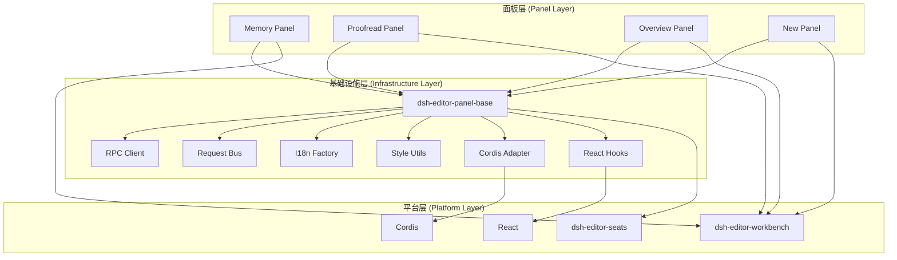

# Phase 2: 面板基础设施架构设计

> **历史留档**: 本文档为 Phase 1 设计分析材料，已被 [架构重构权威计划](refactoring/refactoring-plan.md) 整合。保留历史正文供参考。

**日期**: 2026-10-06  
**状态**: 设计方案  
**依赖**: [分析报告](./phase2-panel-analysis.md)

---

## 目录

1. [架构概览](#1-架构概览)
2. [核心接口设计](#2-核心接口设计)
3. [包结构设计](#3-包结构设计)
4. [使用范例](#4-使用范例)
5. [与现有系统集成](#5-与现有系统集成)

---

## 1. 架构概览

### 1.1 设计原则

1. **最小侵入**: 不破坏现有面板的工作方式
2. **渐进采用**: 现有面板可逐步迁移
3. **类型安全**: 完整的 TypeScript 类型推导
4. **零运行时开销**: 尽可能在编译时完成
5. **符合现有约定**: 遵循 DSH Editor 的架构决策

### 1.2 架构分层



### 1.3 设计目标

| 目标 | 方法 | 验证 |
|------|------|------|
| 减少重复代码 60%+ | 提取公共模式到 base | 代码行数对比 |
| 新增面板 < 30 分钟 | 提供模板和工厂 | 实际开发计时 |
| 类型安全 | 泛型 + 类型推导 | TypeScript 编译 |
| 易于理解 | 清晰的接口分层 | Code review |
| 向后兼容 | 不破坏现有 API | 现有面板仍能编译 |

---

## 2. 核心接口设计

### 2.1 RPC 通信层

完整代码见设计文档附录，核心包括：

- `RpcResult<T>`: 统一的成功/失败类型
- `safeRpcCall<T>`: 安全的异步调用包装
- `LatestRequestGate`: 竞态条件防护
- `errorMessage`: 智能错误映射

### 2.2 请求总线

泛型化的发布/订阅系统：

```typescript
type BasePanelRequest = { nonce: number }

interface PanelRequestBus<TRequest extends BasePanelRequest> {
  request(payload?: Omit<TRequest, 'nonce'>): TRequest
  pending(): TRequest | null
  consume(request: TRequest): void
  subscribe(listener: (req: TRequest) => void): () => void
}

function createPanelRequestBus<TRequest>(): PanelRequestBus<TRequest>
```

### 2.3 其他核心模块

- **国际化工厂**: `createPanelI18n<TKey>(config)`
- **样式工具**: `panelContainerStyles(config)`, `injectPanelStyles(name, css)`
- **Cordis 适配器**: `createPanelClient(config)`
- **React 钩子**: `usePanelRequest`, `usePanelRpc`

---

## 3. 包结构设计

```
dsh-editor-panel-base/
├── src/
│   ├── index.ts              # 主入口
│   ├── rpc.ts                # RPC 通信层
│   ├── request-bus.ts        # 请求总线
│   ├── i18n.ts               # 国际化工厂
│   ├── styles.ts             # 样式工具
│   ├── cordis-adapter.ts     # Cordis 适配器
│   └── hooks.ts              # React 钩子
├── package.json
├── tsconfig.json
└── README.md
```

**依赖关系**:
- peer: `@deepseek-ai/cordis`, `react`
- dev: `dsh-editor-seats`, `typescript`, `tsdown`

---

## 4. 使用范例

### 简单计数器面板（80 行 vs 原 150 行）

```typescript
// requests.ts
import { createPanelRequestBus, type BasePanelRequest } from 'dsh-editor-panel-base'
const bus = createPanelRequestBus<BasePanelRequest>()
export const requestCounter = () => bus.request()

// messages.ts  
import { createPanelI18n } from 'dsh-editor-panel-base'
export const i18n = createPanelI18n({ zh: {...}, en: {...} })

// styles.ts
import { panelContainerStyles } from 'dsh-editor-panel-base'
export const styles = panelContainerStyles({ panelName: 'counter' }) + `...`

// client.tsx
import { createPanelClient } from 'dsh-editor-panel-base'
export const { name, inject, apply } = createPanelClient({
  panelName: 'counter',
  styles,
  slot: { slotName: SIDEBAR_TOOLS_SLOT, ... },
  commands: [...],
  createRender: (rpc) => (props) => <CounterSeat {...props} rpc={rpc} />
})
```

---

## 5. 与现有系统集成

- `panel-base` 不依赖 `workbench`（避免循环）
- 面板包直接调用 workbench RPC 端点
- 向后兼容：现有面板可继续使用原有代码

---

## 下一步

1. 审查本设计文档
2. 阅读 [迁移计划](./phase2-migration-plan.md)
3. 参考 [实施指南](./phase2-implementation-guide.md)
