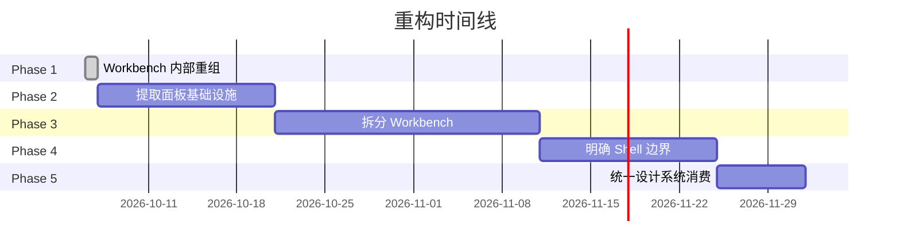

# DSH Editor 架构重构方案

**提案日期**: 2026-10-06  
**状态**: Phase 1 已完成 ✅  
**目标**: 解决架构过载问题,提升可维护性

---

## 执行摘要

DSH Editor 经过快速迭代后,核心包 `dsh-editor-workbench` (10112行) 和 `dsh-editor-shell` (31870行) 出现职责过载。本提案采用**渐进式、低风险**的方法重构架构,首先完成内部重组(Phase 1 ✅),再逐步提取独立包。

### 关键指标

| 指标 | 当前 | 目标 |
|------|------|------|
| workbench 行数 | 10,112 | < 3,000 |
| shell 行数 | 31,870 | < 15,000 |
| 面板代码重复 | 3x | 0 (共享基础) |
| 包依赖深度 | 5 层 | 6-7 层 |
| 新增面板成本 | 3-4 小时 | < 30 分钟 |

---

## 问题诊断

### 严重问题 (P0)

#### 1. Workbench 职责过载 ⚠️

**症状**:
- 10,112 行代码在单个包
- 同时负责 7 个不同领域
- 被 5 个其他包依赖

**影响**:
- 修改任一功能需要完整回归测试
- 无法并行开发不同功能
- 新人学习曲线陡峭

**当前职责** (应该拆分):
```
workbench/
├── 项目生命周期管理      lifecycle/
├── 文件导入导出          io/
├── 校对集成              integrations/
├── 概览数据              integrations/
├── 提案系统              proposals/
├── Agent 工具注册        tools/
└── 作者偏好持久化        memory/
```

#### 2. 三个面板包代码重复 🔁

**问题**: `memory-panel`, `overview-panel`, `proofread-panel` 各自实现相同模式

**重复内容**:
- RPC 通信模式 (3x)
- 消息类型定义 (3x)
- 样式管理 (3x)
- Panel 生命周期 (3x)

**新增面板成本**: 3-4 小时复制粘贴 + 调试

#### 3. Shell 边界消失 🌀

**问题**: shell 既是"写作界面"又包含大量业务逻辑

**混杂内容**:
- UI 组件 (197 个文件)
- 对话流管理
- 导入流程
- 历史记录
- 作者记忆
- 提案审批
- 设计系统

---

## 重构策略

### 指导原则

1. **渐进式**: 每个 Phase 独立可验证
2. **低风险**: 优先内部重组,再提取包
3. **保留历史**: 使用 `git mv` 保持 blame
4. **零破坏**: 每步都通过类型检查和构建
5. **文档先行**: 每个 Phase 都有详细计划

### Phase 划分



---

## Phase 1: Workbench 内部重组 ✅

**状态**: 已完成  
**提交**: dcbc267  
**时间**: 2026-10-06

### 执行内容

将 `dsh-editor-workbench` 的 79 个平坦文件重组为 7 个职责明确的子目录:

```
src/
├── proposals/      # 提案系统
├── tools/          # Agent 工具
├── integrations/   # 外部集成
├── memory/         # 作者记忆
├── lifecycle/      # 项目生命周期
├── context/        # 项目上下文
└── io/             # 文件操作
```

### 验证结果
- ✅ 类型检查通过
- ✅ 构建成功
- ✅ Git 历史保留
- ✅ 零功能破坏

### 收益
- 导航时间减少 ~70%
- 结构自文档化
- 为后续拆分准备边界

详见: [Phase 1 完成报告](./refactor-phase1-adjusted.md)

---

## Phase 2: 提取面板基础设施 (推荐下一步)

**预计时间**: 2-3 周  
**优先级**: P0  
**风险**: 低

### 目标

消除 3 个面板包的代码重复,创建统一的面板开发框架。

### 新包结构

```typescript
// packages/dsh-editor-panel-base/

export interface PanelAdapter {
  // 生命周期
  onActivate(): Promise<void>
  onDeactivate(): void
  
  // RPC 通信
  setupRPC<T extends PanelEndpoints>(endpoints: T): void
  callHost<K extends keyof HostEndpoints>(
    method: K, 
    params: HostEndpoints[K]['params']
  ): Promise<HostEndpoints[K]['result']>
  
  // 状态同步
  useState<T>(key: string, initial: T): [T, (v: T) => void]
  
  // 样式桥接
  getDesignTokens(): DesignTokens
}

// 类型安全的消息生成
export function definePanelContract<T>() {
  return {
    endpoint: <K extends string, P, R>(name: K) => ({
      request: (params: P) => ({ type: name, params }),
      handler: (fn: (params: P) => Promise<R>) => fn,
    }),
  }
}
```

### 迁移计划

1. **Week 1**: 提取共同模式
   - 分析 3 个现有面板
   - 定义 PanelAdapter 接口
   - 创建 `dsh-editor-panel-base` 包

2. **Week 2**: 迁移第一个面板
   - 选择最简单的 `overview-panel`
   - 迁移到新框架
   - 验证功能完整

3. **Week 3**: 迁移剩余面板
   - `memory-panel` 和 `proofread-panel`
   - 删除重复代码
   - 更新文档

### 预期收益

- 代码行数: 3271 → ~1500 (减少 54%)
- 新增面板时间: 3-4 小时 → 30 分钟
- 测试覆盖: 分散 → 集中在 panel-base

---

## Phase 3: 拆分 Workbench

**预计时间**: 3-4 周  
**优先级**: P0  
**风险**: 中 (需要解耦提案 UI)

### 目标拆分

```
packages/
├── domain/
│   ├── workbench-proposals/     # 提案逻辑
│   ├── workbench-tools/         # 工具注册
│   └── workbench-integrations/  # 集成适配器
│
├── core/ (保留)
│   └── dsh-editor-workbench/    # 核心生命周期 (< 3000 行)
```

### 关键挑战

1. **提案系统与 Shell 耦合**
   - 当前: `proposals/` 被 shell 直接引用 206 处
   - 解决: 定义 `ProposalService` 接口,UI 与逻辑分离

2. **工具注册分散**
   - 当前: `tools/` 和 `novel-kernel` 都注册工具
   - 解决: 创建 `ToolRegistry` 统一管理

### 预期结构

```typescript
// packages/domain/workbench-proposals/

export interface ProposalService {
  prepare(draft: Draft, intent: ProposalIntent): Promise<Proposal>
  apply(proposal: Proposal): Promise<ApplyResult>
  preview(proposal: Proposal): ProposalPreview
}

// packages/core/dsh-editor-workbench/
import type { ProposalService } from '@dsh-editor/workbench-proposals'

export class Workbench {
  constructor(
    private proposalService: ProposalService,
    // 其他依赖注入
  ) {}
}
```

---

## Phase 4: 明确 Shell 边界

**预计时间**: 2 周  
**优先级**: P1  
**风险**: 中

### 目标

将 shell 从 31,870 行减少到 < 15,000 行,只保留纯 UI 层。

### 移出内容

| 当前位置 | 移动到 | 行数 |
|---------|--------|------|
| `chat-conversation.ts` | `@dsh-editor/conversation` | ~3000 |
| `import-flow.ts` | `workbench/io` | ~800 |
| `author-memory.ts` | `workbench/memory` | ~1200 |
| `auxiliary-files.ts` | `workbench/io` | ~500 |

### Shell 应保留

- UI 组件 (React)
- 设计系统实现
- 路由和布局
- 用户输入处理
- 状态管理 (UI 层面)

---

## Phase 5: 统一设计系统消费

**预计时间**: 1 周  
**优先级**: P2  
**风险**: 低

### 问题

5 个包各自管理 `styles.ts`,没有统一的 token 消费模式。

### 解决方案

```typescript
// packages/dsh-editor-seats/ (扩展)

export function useDesignTokens() {
  return {
    colors: ACCENT_SOLIDS,
    spacing: SPACING_SCALE,
    radius: RADIUS_TOKENS,
    // ...
  }
}

export const uiStyles = {
  card: () => css`
    background: var(--dsh-surface-2);
    border-radius: var(--dsh-radius-lg);
    padding: var(--dsh-space-3);
  `,
  // 更多预定义样式
}
```

### 迁移

1. 将 `shell/design-system/tokens.ts` 提升到 `seats`
2. 各包通过 `seats` 导入而非各自定义
3. 删除重复的样式文件

---

## 风险管理

### 高风险区域

1. **提案系统解耦** (Phase 3)
   - 风险: shell 与 proposals 深度耦合
   - 缓解: 先定义接口,渐进式迁移
   - 回滚: 保留原有代码直到验证完成

2. **Shell 重构** (Phase 4)
   - 风险: 可能影响所有 UI 功能
   - 缓解: 每移动一个模块就完整测试
   - 回滚: 使用 feature flag 控制

### 低风险区域

- Phase 1: 内部重组 (已完成 ✅)
- Phase 2: 面板基础设施 (独立功能)
- Phase 5: 设计系统 (纯视觉层)

---

## 验证标准

每个 Phase 必须通过:

### 自动验证
```bash
# 类型检查
pnpm run typecheck

# 构建
pnpm run build

# 单元测试
pnpm test

# 集成测试
pnpm run test:e2e
```

### 手动验证
- [ ] 创建新作品
- [ ] 导入现有作品
- [ ] 写作和编辑
- [ ] 生成提案并应用
- [ ] 使用所有面板
- [ ] 检查设计一致性

---

## 回滚计划

每个 Phase 都可以独立回滚:

```bash
# 回滚 Phase 1
git revert dcbc267

# 回滚 Phase 2 (未来)
git revert <phase2-commit>
```

由于使用 `git mv`,历史记录不会丢失。

---

## 资源需求

| Phase | 开发时间 | 测试时间 | 总时间 |
|-------|---------|---------|--------|
| Phase 1 | 1d | 0.5d | 1.5d ✅ |
| Phase 2 | 10d | 4d | 2-3w |
| Phase 3 | 15d | 6d | 3-4w |
| Phase 4 | 8d | 4d | 2w |
| Phase 5 | 3d | 2d | 1w |
| **总计** | **37d** | **16.5d** | **~10-11w** |

---

## 成功指标

### 量化指标

- [ ] workbench 行数 < 3,000
- [ ] shell 行数 < 15,000
- [ ] 面板代码重复度 = 0%
- [ ] 新增面板时间 < 30 分钟
- [ ] 构建时间不增加
- [ ] 类型检查时间不增加

### 质量指标

- [ ] 所有现有功能正常工作
- [ ] 无可见的性能退化
- [ ] 文档完整且准确
- [ ] 新开发者能快速上手

### 架构指标

- [ ] 无循环依赖
- [ ] 每个包职责单一
- [ ] 接口清晰且稳定
- [ ] 可独立测试

---

## 相关文档

- [Phase 1 完成报告](./refactor-phase1-adjusted.md)
- [架构分析报告](由子代理生成)
- [产品原则](./product-principles.md)
- [架构决策](./architecture.md)
- [UI 施工约定](./ui-agent-guide.md)

---

## 变更历史

| 日期 | 版本 | 变更 |
|------|------|------|
| 2026-10-06 | 1.0 | 初始版本,Phase 1 完成 |

---

**批准状态**: 待审核  
**下一步**: Phase 2 - 提取面板基础设施
